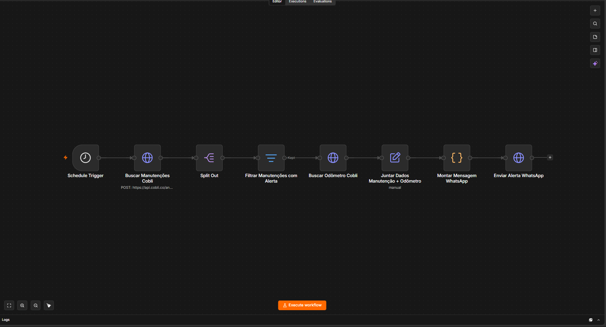
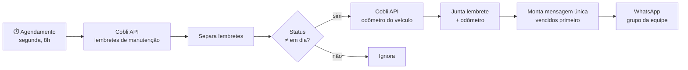

# Reminder Automation — Lembretes de manutenção Cobli → WhatsApp

Automação em [n8n](https://n8n.io) que verifica toda semana os lembretes de manutenção da frota cadastrados na **Cobli** e envia ao grupo de WhatsApp da equipe um resumo único com os veículos que têm manutenção **vencida** ou **próxima do vencimento**.


## O problema

A Cobli calcula quando cada veículo precisa de manutenção (troca de óleo, revisão, pneus etc.), mas essa informação fica dentro da plataforma. Para não deixar nada vencer, alguém precisava entrar no sistema, conferir os lembretes veículo a veículo e avisar os responsáveis por cada bolsão. Era um trabalho manual e fácil de esquecer.

## Como funciona





1. **Coleta:** toda segunda-feira, às 8h, o fluxo busca na API da Cobli a lista de lembretes de manutenção da frota.
2. **Filtro:** só seguem os lembretes com status diferente de `ON_TIME`, ou seja, `DELAYED` (vencido) e `WARNING` (em breve).
3. **Enriquecimento:** para cada lembrete, o fluxo consulta o odômetro atual do veículo, para mostrar quantos km ele já rodou.
4. **Mensagem:** um nó de código monta **uma única mensagem** com todos os alertas, vencidos primeiro. Cada bloco traz bolsão, placa, modelo, serviço, recorrência, quanto falta (ou há quanto venceu, em km ou dias) e a ação esperada.
5. **Envio:** a mensagem vai para o grupo de WhatsApp da equipe pelo [WAHA](https://waha.devlike.pro) (WhatsApp HTTP API), endpoint `/api/sendText`.

### Exemplo de mensagem

```text
📍 *BOLSÃO: CENTRO*

🚗 *VEÍCULO*
Placa: *ABC1D23*
Modelo: Fiat Strada - 2022

🔧 *MANUTENÇÃO*
Serviço: Troca de óleo
Observação: Óleo + filtro
Recorrência: A cada 10.000 km

📊 *SITUAÇÃO*
Status: 🔴 *Vencido*
Vencido há: *1.250 km*
KM atual: *61.250 km*
Limite: *60.000 km*

🚨 *AÇÃO NECESSÁRIA*
Providenciar a manutenção com prioridade.

━━━━━━━━━━━━━━

📍 *BOLSÃO: ZONA SUL*
...
```

## Decisões de projeto

- **Uma mensagem por execução:** os alertas são consolidados num único resumo, em vez de uma mensagem por veículo, para não poluir o grupo.
- **Prioridade visual:** vencidos (🔴) aparecem antes dos que estão perto do limite (🟠), e cada um traz a ação esperada.
- **Sem alerta, sem mensagem:** se nenhum lembrete estiver vencido ou perto do vencimento, nada é enviado.
- **Km ou dias:** a mensagem usa o critério que o lembrete tiver (quilometragem ou prazo em dias), tanto na recorrência quanto no limite.

## Como usar

1. No n8n: **Workflows → Import from File** → `workflows/Automação_de_Lembretes.json`.
2. Nos nós **Buscar Manutenções Cobli** e **Buscar Odômetro Cobli**, preencha `cobli-api-key` (marcado com `<<PREENCHER>>`) com sua chave da API Cobli. De preferência, configure-a como credencial Header Auth.
3. No nó **Enviar Alerta WhatsApp**:
   - troque `http://127.0.0.1:3000` pelo endereço da sua instância do WAHA;
   - ajuste `session` para o nome da sessão no WAHA e preencha `chatId` com o ID do grupo que vai receber os alertas (formato `...@g.us`).
4. Se quiser, mude o dia e o horário no **Schedule Trigger**.
5. Ative o fluxo.

## Segurança

O fluxo publicado aqui não tem credenciais, chaves de API, endereços internos, IDs de grupos nem dados reais de execução. Todos os valores sensíveis foram substituídos por marcadores (`<<PREENCHER>>`).
